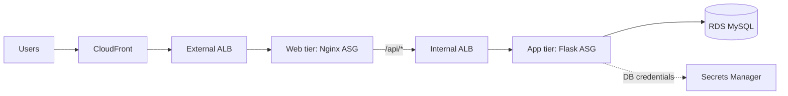

# AWS Three-Tier E-Commerce Application

A small e-commerce app (product catalogue, cart, checkout, order history) built as a three-tier architecture for AWS: Nginx web tier, Flask API tier, and MySQL on RDS, behind CloudFront and two load balancers.

## Architecture



The browser only talks to its own origin: Nginx serves the static pages and forwards `/api/*` to the internal load balancer, so the API is never exposed to the internet directly. Full network layout, IAM roles and scaling design: [docs/architecture.md](docs/architecture.md).

## Features

- Product catalogue loaded from the database
- Per-browser carts (an anonymous client ID, so visitors don't share a cart)
- Checkout creates an order with line items and the price paid
- Order history endpoint
- Health endpoint for load balancer checks

## Tech stack

Python, Flask, gunicorn, MySQL (RDS), Nginx, HTML/CSS/JavaScript, AWS (VPC, EC2, Auto Scaling, ALB, CloudFront, RDS, IAM, Secrets Manager, CloudWatch).

## Repository structure

```
.
├── frontend/       static site (HTML, CSS, JS)
├── backend/        Flask API (app.py, config.py, routes/)
├── database/       schema.sql (tables and sample products)
├── deploy/         Nginx config, systemd unit, env template for the AWS tiers
└── docs/           architecture.md
```

## API

| Method | Path | Description |
|---|---|---|
| GET | `/health` | Load balancer health check |
| GET | `/products` | List products |
| GET | `/cart` | The caller's cart |
| POST | `/cart/add` | Body `{"product_id": 1}` adds one unit |
| DELETE | `/cart/remove/<id>` | Remove an item from the caller's cart |
| POST | `/checkout` | Turn the cart into an order |
| GET | `/orders` | The caller's orders |

Cart and order calls need an `X-Client-Id` header, which the frontend sets automatically.

## Run it locally

Requirements: Python 3.10+ and MySQL 8.

```bash
# 1. Database
mysql -u root -p < database/schema.sql
# create a dedicated user instead of using root:
#   CREATE USER 'ecommerce_app'@'localhost' IDENTIFIED BY 'your-password';
#   GRANT SELECT, INSERT, UPDATE, DELETE ON ecommerce.* TO 'ecommerce_app'@'localhost';

# 2. Backend
cd backend
python -m venv venv && source venv/bin/activate      # Windows: venv\Scripts\activate
pip install -r requirements.txt
cp .env.example .env                                 # then edit DB_USER / DB_PASSWORD
export $(grep -v '^#' .env | xargs)                  # or set the variables your own way
python app.py                                        # http://localhost:5000

# 3. Frontend (second terminal)
cd frontend
python -m http.server 8000                           # http://localhost:8000
```

## Configuration

| Variable | Purpose | Default |
|---|---|---|
| `DB_HOST`, `DB_PORT`, `DB_NAME` | Database location | `localhost`, `3306`, `ecommerce` |
| `DB_USER`, `DB_PASSWORD` | Local credentials | required unless `DB_SECRET_ARN` is set |
| `DB_SECRET_ARN` | Read credentials from AWS Secrets Manager (AWS deployment) | unset |
| `CORS_ORIGINS` | Allowed browser origins (local development) | `http://localhost:8000` |
| `FLASK_DEBUG` | `1` enables debug mode, local use only | off |

No credentials are stored in the code.

## Deploying on AWS (outline)

1. **Network:** VPC with public, web, app and DB subnets across two AZs, NAT, security groups chained tier to tier.
2. **Database:** RDS MySQL (Multi-AZ) with a managed master secret. Load `database/schema.sql`.
3. **App tier:** Ubuntu instances in an Auto Scaling Group behind the internal ALB (health check `/health`). Install the backend under `/opt/ecommerce`, use `deploy/ecommerce-backend.service` and `deploy/ecommerce.env.example`. The instance role needs permission to read the DB secret.
4. **Web tier:** Nginx instances in an Auto Scaling Group behind the external ALB. Copy `frontend/` to `/var/www/html` and use `deploy/nginx.conf` with your internal ALB's DNS name.
5. **CloudFront** in front of the external ALB.

Details and security design: [docs/architecture.md](docs/architecture.md).

## Security notes

- Prices come from the database. The server ignores any price sent by the browser, so a cart can't be tampered with.
- All SQL is parameterised. User-supplied text is escaped before it is rendered.
- Credentials come from environment variables or Secrets Manager, never from source code.
- Flask debug mode is off unless explicitly enabled (it must never be on when reachable from a network).
- Carts and orders are scoped to the caller, and a cart item can only be removed by its owner.
- The app tier sits in private subnets; only the load balancer path is public.

## Limitations

- There are no user accounts or payment processing. Carts are tied to a random browser ID, which is fine for a demo but not for a real shop.
- HTTPS depends on CloudFront or an ACM certificate on the load balancer.
- No automated tests or CI yet.

## License

No license has been added yet.
