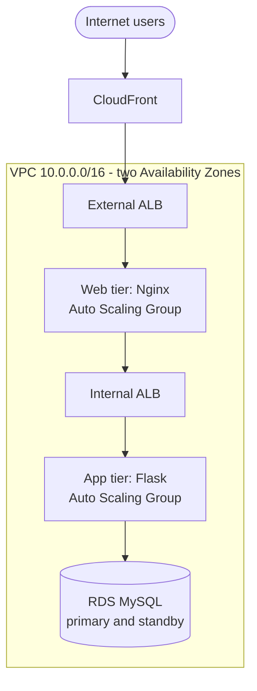

# Architecture

AWS three-tier, highly available e-commerce platform: a static web tier (Nginx), an API tier (Flask) and a managed database (RDS MySQL), spread across two Availability Zones behind CloudFront and two load balancers.

## Overview



## Request flow

1. A user requests the site. **CloudFront** serves it from the nearest edge location and forwards requests it can't answer.
2. The **external ALB** (public subnets) spreads traffic across the web servers.
3. **Nginx** (private web subnets) serves the static pages and forwards `/api/*` calls to the internal ALB.
4. The **internal ALB** spreads API traffic across the application servers.
5. **Flask** (private app subnets) runs the business logic and queries the database.
6. **RDS MySQL** (private DB subnets) stores products, carts and orders. The response travels back along the same path.

## Network layout

```text
AWS Region
│
└── VPC (10.0.0.0/16)
    │
    ├── Availability Zone A
    │   │
    │   ├── Public Subnet A
    │   │   ├── NAT Gateway A
    │   │   ├── External ALB
    │   │   └── Bastion Host
    │   │
    │   ├── Private Web Subnet A
    │   │   └── Nginx Web Server
    │   │
    │   ├── Private App Subnet A
    │   │   └── Flask App Server
    │   │
    │   └── Private DB Subnet A
    │       └── RDS MySQL Primary
    │
    └── Availability Zone B
        │
        ├── Public Subnet B
        │   ├── NAT Gateway B
        │   └── External ALB
        │
        ├── Private Web Subnet B
        │   └── Nginx Web Server
        │
        ├── Private App Subnet B
        │   └── Flask App Server
        │
        └── Private DB Subnet B
            └── RDS MySQL Standby
```

## Security design

| Layer | Who can reach it | How |
|---|---|---|
| CloudFront and external ALB | The internet | The only public entry points |
| Web tier | External ALB only | Security group allows traffic only from the ALB |
| Internal ALB | Web tier only | Not internet-facing |
| App tier | Internal ALB only | Private subnets, no public IPs |
| Database | App tier only | Private DB subnets; security group allows the database port only from the app servers |

Application servers cannot be reached directly from the internet. Administrative access goes through the bastion host or SSM Session Manager.

## IAM roles

| Role | Permissions |
|---|---|
| `EC2-WebServer-Role` | CloudWatch Logs, SSM Session Manager, read-only access to application assets |
| `EC2-AppServer-Role` | CloudWatch Logs, Secrets Manager (database credentials), RDS connectivity |
| CloudFront | Access to the application content origins |

Each tier gets its own role with only the permissions it needs (least privilege).

## High availability

- Two Availability Zones for every tier, so one AZ failing doesn't take the site down
- Auto Scaling Groups replace unhealthy web and app servers automatically
- Two load balancers with health checks (the API exposes `/health`)
- RDS Multi-AZ: automatic failover to the standby database
- CloudFront edge locations in front of the whole stack

## Scaling strategy

| Tier | Scale out | Scale in |
|---|---|---|
| Web (Nginx) | Average CPU above 70% | Average CPU below 30% |
| App (Flask) | Request count per target rises | Low utilisation |

## AWS services used

| Area | Services |
|---|---|
| Networking | VPC, Internet Gateway, NAT Gateway, route tables, subnets and security groups |
| Compute | EC2, launch templates, Auto Scaling Groups |
| Load balancing | External and internal Application Load Balancers |
| Database | RDS MySQL (Multi-AZ) |
| Content delivery | CloudFront |
| Security | IAM roles, security groups, Secrets Manager |
| Monitoring | CloudWatch metrics and logs |

## How the application maps onto the tiers

| Tier | Runs | Notes |
|---|---|---|
| Web | Nginx on EC2 (Auto Scaling Group) | Serves `frontend/` and forwards `/api/*` to the internal ALB (`deploy/nginx.conf`) |
| App | Flask under gunicorn on EC2 (Auto Scaling Group) | `deploy/ecommerce-backend.service`; load balancer health check path `/health` |
| Data | RDS MySQL | Schema in `database/schema.sql`; credentials from Secrets Manager (`DB_SECRET_ARN`) |

The browser calls relative `/api/...` URLs, so CloudFront, the external ALB and Nginx handle everything on one origin and the API is never reachable from the internet directly.

## Repository structure

```text
frontend/    static site
backend/     Flask API
database/    schema and sample data
deploy/      Nginx config, systemd unit, env template
docs/        this document
README.md
.gitignore
```
